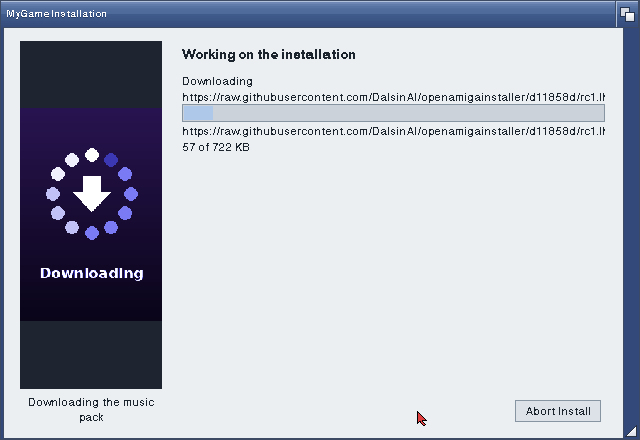
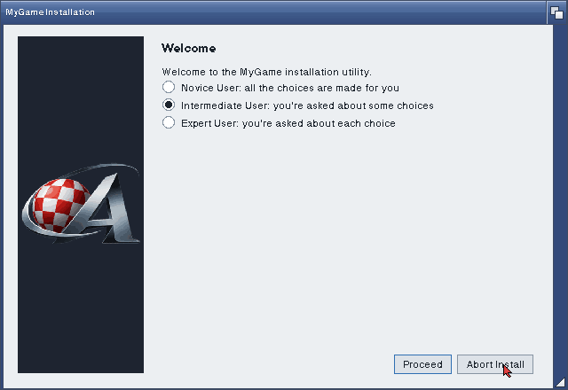
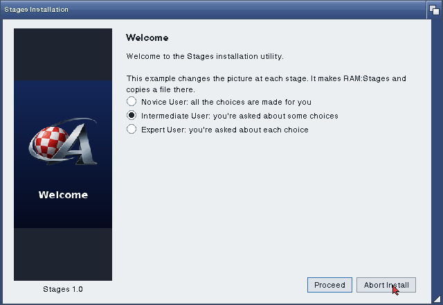
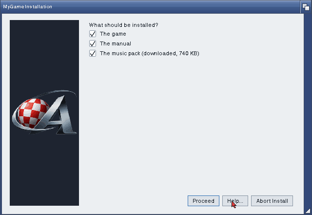
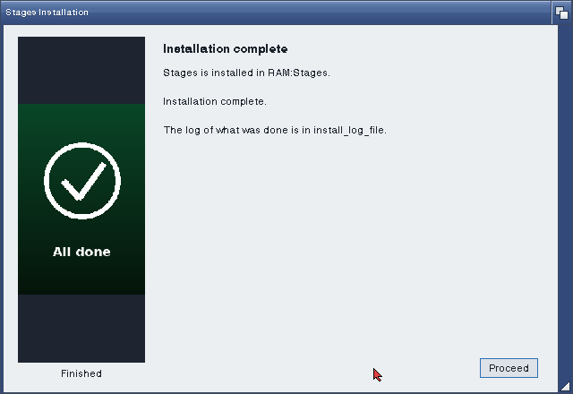
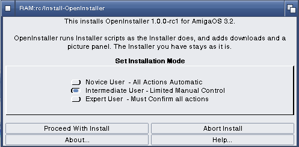
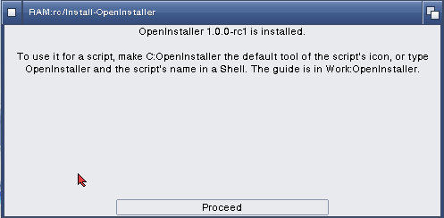

# OpenInstaller

An Installer for AmigaOS 3.2 that runs the Installer scripts you already
have, written from scratch by the AmigaChrome Team. It reads the same
script language as Commodore's Installer (it copies the OS 3.2 Installer
47.19: `@installer-version` says 47.19) and adds a few commands of its own:

- **(download)** fetches a missing file over HTTP or HTTPS with the
  built-in libcurl, on a page of the Installer's own with a progress bar,
  so the install carries on in sequence.
- **(netavailable)** tells a script whether there's a network.
- **(panel)** changes the picture in a panel down the left quarter of the
  window: IFF, PNG or animated GIF, through datatypes. With no picture the
  panel shows the AmigaChrome logo.

The details are in [docs/Extras.md](docs/Extras.md). How to write a
script that uses them, with examples, is in [docs/Guide.md](docs/Guide.md),
and the scripts in [examples/](examples/) show each one.



## What it looks like

These were taken on AmigaOS 3.2.3 (a 68040 with an RTG screen), running
the scripts in `Examples` and the archive's own Install-OpenInstaller.

| | |
| --- | --- |
|  |  |
| With no `(panel)` the panel shows the AmigaChrome logo. | A script's picture and caption (Install-Stages). |
|  |  |
| `askoptions`, as the Installer asks it. | The last page, with another picture. |

Install-OpenInstaller is an ordinary Installer script, so the Installer
AmigaOS 3.2 has installs OpenInstaller:

| | |
| --- | --- |
|  |  |

## The window

The window is built with GFOpenLayout (gfopenlayout.library 11), in the
theme GFOpenPrefs Look chose. Without that library OpenInstaller opens the
same pages with GadTools. Either way the text is in the screen's font, as
your Font prefs set it.

## Running it

From the Shell, with the Installer's arguments:

```
OpenInstaller SCRIPT/A,APPNAME/K,MINUSER/K,DEFUSER/K,LOGFILE/K,LANGUAGE/K,NOPRETEND/S,NOLOG/S,PRETEND/S,HEADLESS/S
```

From Workbench, make OpenInstaller the default tool of a script's icon:
the tool types are the same names (`APPNAME=`, `MINUSER=` and so on), and
without `SCRIPT` the icon's own file is the script.

`HEADLESS` runs with no window, printing each page and taking the
defaults.

## What's in the archive

`OpenInstaller-<version>-amiga-68040.lha` holds the `OpenInstaller` drawer:

- `OpenInstaller`, the program (68040)
- `Libs/gfopentls.library` and `S/GFOpenTLS/ca-bundle.pem`, for HTTPS:
  copy them to `LIBS:` and `S:GFOpenTLS/` if you don't have them
- `Examples/` (three scripts and their pictures), `Guide.md`,
  `Extras.md`, this README, the licences

Beside the drawer is **Install-OpenInstaller**, which puts all of it in
place with the Installer you already have.

Scripts written for OpenInstaller still run on Commodore's Installer when
they test `@openinstaller` before using the extras.

## Building

`make test` builds the interpreter for this machine with a text front end
and runs the tests (`tests/`: the language, file installs and the
extras, with a local web server for the downloads). `make asan` does the
same with AddressSanitizer.

`package/amiga/build-ci.sh VERSION OUTDIR` builds the Amiga program with
the Team's toolchain, OpenNDK, gfopenlayout's headers, libcurl and
gfopentls.library, all pinned, and packs the archive.

## Licence

MIT. Copyright (c) 2026 AmigaChrome Team.

Designed, tested and delivered by The AmigaChrome Team.
