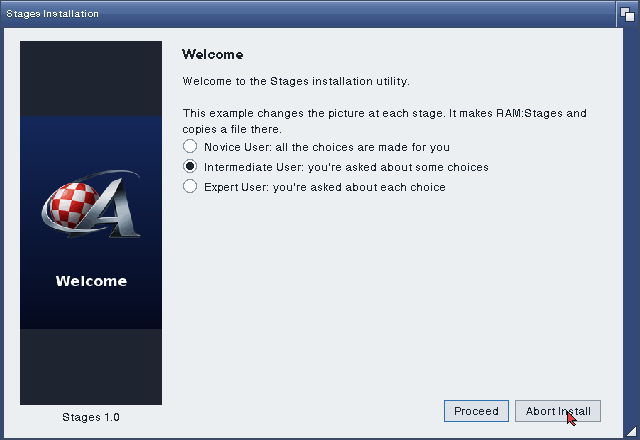
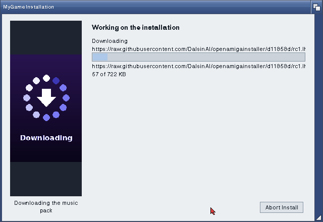
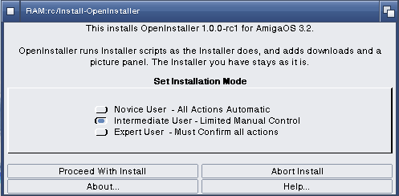

# How to write an install with OpenInstaller

This guide starts from an empty script and works up to an install that
downloads what it needs and shows a picture at each stage. Every script
here also runs as it is on the Installer AmigaOS 3.2 has. The extras are
the only thing that needs OpenInstaller, and a script can test for them.

The examples are in the archive's `Examples` drawer (and in `examples/` in
the repository). Each one has an icon whose default tool is
`C:OpenInstaller`, so a double-click runs it.

| Example | What it shows |
| --- | --- |
| [Install-Stages](../examples/Install-Stages) | a picture for each stage, with captions |
| [Install-Download](../examples/Install-Download) | a download with a SHA-256 check, and a way on with no network |
| [Install-Both](../examples/Install-Both) | one script for OpenInstaller and the classic Installer |


## 1. Running a script

From Workbench, give the script an icon (a project icon) whose default
tool is `C:OpenInstaller`. These tool types are read from it, the same
ones the Installer reads:

| Tool type | What it does |
| --- | --- |
| `APPNAME=Name` | the name on the pages ("Welcome to the Name installation utility") |
| `MINUSER=NOVICE` | the lowest user level offered (`NOVICE`, `AVERAGE`, `EXPERT`) |
| `DEFUSER=AVERAGE` | the level chosen at first |
| `LOGFILE=T:Name.log` | where the log goes |
| `NOPRETEND`, `NOLOG` | leave out the pretend and log choices |
| `SCRIPT=file` | a script other than the icon's own file |

From a Shell:

```
OpenInstaller Install-Name APPNAME=Name DEFUSER=AVERAGE
```

`PRETEND` starts in pretend mode, where nothing on the disk changes, and
`HEADLESS` runs with no window and takes every default. Both are good
ways to try a script out.

## 2. The smallest install

```
(set @app-name "Hello")
(welcome)
(set #dest (askdir (prompt "Where should Hello go?")
                   (help @askdir-help)
                   (default @default-dest)))
(copyfiles (prompt "Copying Hello")
           (help @copyfiles-help)
           (source "Hello")
           (dest #dest)
           (infos))
(exit "Hello is installed in " #dest ".")
```

- `(welcome)` shows the first pages: the user level, then install or
  pretend and the log. Above Novice level both pages are shown.
- Any variable can be a `#name`; the `@` names are the Installer's own.
  `@default-dest` starts as `Work:` when there is one, else `SYS:`.
- `(copyfiles)` copies a file, or what a drawer holds, into `(dest)`. `(infos)` takes the icons too.
- `(exit)` shows its text and ends the install.

## 3. Asking the user

```
(set #what (askoptions (prompt "What should be installed?")
                       (help @askoptions-help)
                       (choices "The program" "The manual" "Example files")
                       (default %011)))
(if (IN #what 0) (copyfiles (source "Prog") (dest #dest)))
(if (IN #what 1) (copyfiles (source "Docs") (dest #dest)))
```

`askchoice` takes one choice (its number), `askoptions` any of them (a
mask of bits; `%011` is the first two), `askbool` yes or no, `asknumber`
a number in `(range lo hi)`, `askstring` text, `askdir` and `askfile` a
drawer or a file. At Novice level the ask functions don't show a page.
They return their default, so give each one a good default.

`(confirm)` on `copyfiles`, `copylib`, `delete` and the rest asks first:
above Novice with `(confirm)`, only at Expert with `(confirm "expert")`.

## 4. When something goes wrong

```
(onerror
    (message "The install stopped: " @error-msg))

(trap 8 (copyfiles (source "Extras") (dest #dest)))   ; 8: a DOS error
(if @ioerr (message "The extras were left out."))
```

`(onerror)` runs once when the install fails or the user stops it. `(trap)`
catches an error inside it, so the install goes on. `(optional "nofail")`
does the same for one copy or download. `@ioerr` says what happened.

## 5. The picture panel

The window has a panel down its left quarter. It shows the AmigaChrome
logo until a script names a picture, and again after `(panel "")`.

```
(panel "Pictures/welcome.png" (caption "MyGame 2.0"))
```



Pictures are read with datatypes, so IFF ILBM, PNG, GIF and anything else
a datatype reads will do. An animated GIF plays when gfopengif.datatype is
installed. With another GIF datatype its first frame shows. The picture is
scaled to fit the panel, keeping its shape.

Ways to use it:

- **A picture for each stage.** Change the picture before each part of
  the install (welcome, choosing, copying, downloading, finished), so the
  user can see where the install has got to. [Install-Stages](../examples/Install-Stages)
  does this.
- **Something to look at while it works.** Put an animated GIF up before
  a long copy or a download, and change back after.
- **Marketing.** Show the box art, screenshots of the program, or what's
  new, one at a time as the install goes on. Captions say what each
  picture is.
- **Leave it.** A script that never calls `(panel)` gets the logo all the
  way through.

The panel is a quarter of the window wide and as tall as the page, about
2 by 3. A picture of 200 by 300 pixels fits the default window without
scaling. The pictures in `Examples/Pictures` are that size.

Find the pictures from where the script is. `@icon` is the script's own
path, from the Shell too:

```
(set #pics (tackon (pathonly (expandpath @icon)) "Pictures"))
(panel (tackon #pics "copying.iff") (caption "Copying the files"))
```

`(panel)` returns 0 when the picture isn't there. The panel then stays as
it was, so a missing picture never stops an install.

## 6. Downloading what the archive doesn't carry

```
(if (netavailable)
    (download (prompt "Downloading the data files")
              (source "https://example.org/mygame/data-2.0.lha")
              (dest "T:")
              (checksum "9f86d081884c7d659a2feaa0c55ad015a3bf4f1b2b0b822cd15d6c15b0f00a08")
              (ifmissing))
    (abort "MyGame needs its data files, and there's no network. Start your TCP/IP stack and run the install again."))
```

The download has a page of its own in the Installer window, with a bar
that shows the bytes so far against the size and an Abort button. The
script waits for it, so the install goes on in order.



- `(dest)` a drawer keeps the file's own name; a file name gives it
  another.
- The file is written as `NAME.part` and renamed when it's all there.
  A download that stops picks up where it stopped, up to four tries.
- `(checksum)` is the file's SHA-256 in hex (`sha256sum file` on Linux,
  `shasum -a 256 file` on macOS). When it doesn't match, the file is
  deleted and the download fails.
- `(ifmissing)` fetches only when the file isn't there yet, so running the
  install a second time doesn't download it again.
- In pretend mode nothing is fetched unless you give `(safe)`.

HTTPS needs gfopentls.library in `LIBS:` and its certificate list in
`S:GFOpenTLS/`. Install-OpenInstaller puts both there.

### Approaches

**Try a mirror when the first one fails.** `(optional "nofail")` makes a
failed download return 0 rather than stop the install:

```
(if (not (download (source "https://one.example.org/data.lha") (dest "T:")
                   (optional "nofail")))
    (download (source "https://two.example.org/data.lha") (dest "T:")))
```

**Download, then unpack.** Fetch the archive to `T:`, unpack it with
`(run)`, then copy as usual:

```
(download (source #url) (dest "T:mygame-data.lha") (ifmissing))
(working "Unpacking the data files")
(run (cat "LhA -q x T:mygame-data.lha " #dest "/"))
```

**Offer the download.** Let the user choose, and say how to get the file
when they don't:

```
(if (askbool (prompt "Download the 40 MB music pack now?") (help "...") (default 1))
    (download (source #music) (dest #dest) (optional "nofail"))
    (message "You can download the music pack later from\n\n" #music))
```

[Install-Download](../examples/Install-Download) fetches a real file over
HTTPS and checks it.

## 7. One script for both Installers

On the classic Installer `@openinstaller` is 0, as any unset variable is.
OpenInstaller sets it to its version (1.0 is `1<<16`). Put each extra
behind it:

```
(if @openinstaller
    (panel "Pictures/welcome.png"))
(if @openinstaller
    (download (source #url) (dest #dest))
    (message "Download " #url " and put it in " #dest ", then click Proceed."))
```

[Install-Both](../examples/Install-Both) does it for every extra.

## 8. Trying it out

- **Pretend.** Choose "Pretend to install" on the second page, or give
  `PRETEND`. Every step is shown and logged, and nothing changes.
- **The log.** Choose "To a log file". It goes to `LOGFILE`, or to
  `install_log_file` in the drawer the script was started from.
- **`(debug)`** prints its values to the Shell OpenInstaller was started
  from.
- **HEADLESS** runs the whole script with the defaults and prints each
  page in the Shell. It's useful for a quick check after a change.

## 9. Shipping it

Put the script, its icon and the pictures beside what it installs, as the
examples are laid out:

```
MyGame/
  Install-MyGame        the script
  Install-MyGame.info   default tool C:OpenInstaller, APPNAME=MyGame
  Pictures/             the panel's pictures
  MyGame/               what gets copied
```

When your users may not have OpenInstaller yet, write the script for both
Installers (section 7) and make the icon's default tool
`SYS:System/Installer`. Users who have OpenInstaller can switch the
default tool to `C:OpenInstaller` and get the extras.

Install-OpenInstaller itself is a script of that kind, with no extras, so
the Installer AmigaOS 3.2 has runs it:



The extras are listed one by one in [Extras.md](Extras.md).
